# Sistem Informasi Akademik (SIAKAD) — PHP Native MVC

> **Tugas Praktikum 8 — Desain dan Pemrograman Berorientasi Objek (DPBO)**  
> **Program Studi:** Ilmu Komputer, Universitas Pendidikan Indonesia  
> **Arsitektur:** Model–View–Controller (MVC) PHP Native

---

## Janji Kejujuran

Saya **Zufar Ahmad Maulidy** dengan **NIM 2400285** mengerjakan Tugas Praktikum 8 dalam mata kuliah Desain dan Pemrograman Berorientasi Objek untuk keberkahan-Nya maka saya tidak melakukan kecurangan seperti yang telah dispesifikasikan. Aamiin.

---

## Deskripsi Aplikasi & Konteks Tugas

Aplikasi ini merupakan hasil transformasi dan pengembangan dari kode awal CRUD prosedural menjadi aplikasi berbasis **Model–View–Controller (MVC)** menggunakan PHP Native dan basis data MySQL/MariaDB. Sistem ini dirancang untuk mengelola penugasan pengajaran akademik di lingkungan Program Studi Ilmu Komputer UPI.

Sistem mengelola tiga entitas terintegrasi:
1. **Dosen (`lecturers`)**: Entitas awal yang mencatat data pokok dosen (Nama, NIDN unik, No. Telepon, Tanggal Bergabung).
2. **Mata Kuliah (`courses`)**: Entitas tambahan yang mencatat data kurikulum (Kode MK unik, Nama Mata Kuliah, Bobot SKS).
3. **Pengampu Mata Kuliah (`teaching_assignments`)**: Entitas relasi *many-to-many* antara Dosen dan Mata Kuliah, mencatat periode akademik aktif (Semester Ganjil/Genap dan Tahun Akademik format `YYYY/YYYY`).

---

## Diagram Hubungan Entitas (ERD)

Relasi antara Dosen dan Mata Kuliah dimodelkan sebagai hubungan *many-to-many* melalui tabel penghubung `teaching_assignments`.

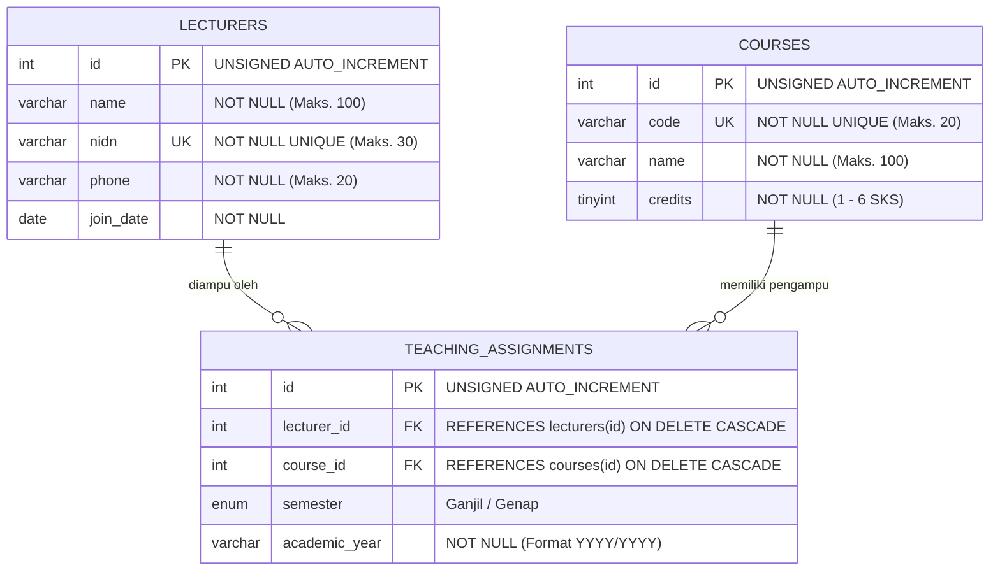

### Konsekuensi Integritas Relasi (CASCADE)
- `ON DELETE CASCADE`: Jika data dosen atau mata kuliah dihapus, seluruh data penugasan pengampu terkait pada tabel `teaching_assignments` akan otomatis terhapus untuk menjaga integritas data.
- Dialog konfirmasi interaktif di antarmuka web selalu mengingatkan pengguna sebelum penghapusan data induk dilakukan.
- `UNIQUE KEY unique_assignment (lecturer_id, course_id, semester, academic_year)`: Mencegah penugasan duplikat untuk dosen, mata kuliah, semester, dan tahun akademik yang sama.

---

## Struktur Direktori Proyek

Proyek ini telah ditata sesuai spesifikasi pengumpulan tugas:

```
TP8/
├── Project/                      # Seluruh kode sumber aplikasi MVC
│   ├── config/                   # Konfigurasi koneksi database
│   │   ├── Database.php          # Koneksi MySQLi singleton dengan error mode strict
│   │   └── database-config.php   # Parameter host, port, user, password, db
│   ├── controllers/              # Pengendali alur aplikasi (Controller)
│   │   ├── Controller.php        # Abstract base controller (CSRF, view, flash)
│   │   ├── LecturerController.php
│   │   ├── CourseController.php
│   │   └── AssignmentController.php
│   ├── models/                   # Lapisan query basis data (Model)
│   │   ├── Lecturer.php          # Prepared statements untuk tabel lecturers
│   │   ├── Course.php            # Prepared statements untuk tabel courses
│   │   └── TeachingAssignment.php# Prepared statements untuk teaching_assignments
│   ├── views/                    # Tampilan halaman web (View)
│   │   ├── layout/               # Header, navigasi, logo, dan footer
│   │   ├── lecturers/            # Form dan tabel dosen
│   │   ├── courses/              # Form dan tabel mata kuliah
│   │   └── assignments/          # Form dan tabel pengampu
│   ├── public/                   # Front controller & aset publik
│   │   ├── index.php             # Router utama aplikasi
│   │   └── assets/               # Logo resmi UPI, CSS khusus, JS, vendor lokal
│   │       ├── upi-logo.png      # Logo resmi Universitas Pendidikan Indonesia
│   │       ├── app.css           # Styling Google Sans & responsive
│   │       ├── app.js            # Skrip aksesibilitas keyboard & label
│   │       └── vendor/           # Bootstrap 5 lokal (offline-first)
│   └── index.php                 # Redirect awal ke public/index.php
├── Dokumentasi/                  # Dokumentasi screenshot & screen recording
│   ├── demo-alur-siakad.gif      # Animasi demonstrasi alur navigasi & CRUD
│   ├── 01-daftar-dosen.png
│   ├── 02-tambah-dosen.png
│   ├── 03-ubah-dosen.png
│   ├── 04-validasi-dosen.png
│   ├── 05-daftar-mata-kuliah.png
│   ├── 06-tambah-mata-kuliah.png
│   ├── 07-ubah-mata-kuliah.png
│   ├── 08-validasi-mata-kuliah.png
│   ├── 09-daftar-pengampu.png
│   ├── 10-tambah-pengampu.png
│   ├── 11-ubah-pengampu.png
│   ├── 12-validasi-pengampu.png
│   └── 13-tampilan-mobile.png
├── database.sql                  # Skema database & data fiktif awal siap impor
└── README.md                     # Panduan komprehensif proyek
```

---

## Desain & Arsitektur MVC

Aplikasi menerapkan pemisahan tugas (*Separation of Concerns*) secara ketat:
- **Model**: Mengelola interaksi basis data menggunakan `mysqli` prepared statements untuk seluruh masukan. Query SQL tidak pernah ditulis di controller atau view.
- **View**: Menampilkan data ke antarmuka pengguna, meng-escape seluruh luaran teks menggunakan `htmlspecialchars` untuk mencegah serangan Cross-Site Scripting (XSS), serta menampilkan pesan validasi kontekstual di bawah masing-masing kolom input.
- **Controller**: Menerima request HTTP, memverifikasi token CSRF, melakukan validasi logika bisnis di sisi server, memanggil method model, dan mengarahkan ke view dengan data yang sesuai.
- **Front Controller (`public/index.php`)**: Menjadi gerbang tunggal request, memetakan rute `route` dan aksi `action` yang sah dari whitelist, serta menolak metode HTTP yang tidak sesuai.

### Validasi
1. **CSRF Protection**: Setiap form yang mengubah data (`store`, `update`, `delete`) dilindungi oleh token CSRF berbasis sesi `$_SESSION['csrf_token']` yang divalidasi dengan `hash_equals`.
2. **Aksi Hapus dengan Metode POST**: Aksi penghapusan data wajib menggunakan metode `POST`. Permintaan `GET` ke aksi hapus tidak akan pernah menghapus data di basis data.
3. **Pola Post/Redirect/Get (PRG)**: Setelah penyimpanan atau pembaruan berhasil, sistem melakukan pengalihan `302 Found` ke halaman index dengan notifikasi flash, sehingga me-refresh halaman tidak akan mengirim form ganda.
4. **Validasi Sisi Server**:
   - Kolom wajib tidak boleh kosong atau hanya berisi spasi.
   - NIDN dan No. Telepon dipertahankan sebagai tipe string agar angka nol di awal tidak hilang.
   - NIDN dan Kode Mata Kuliah harus unik (pada form edit, record yang sedang diedit dikecualikan).
   - SKS dibatasi bilangan bulat antara 1 sampai 6.
   - Tanggal bergabung divalidasi format kalendernya (`checkdate`).
   - Semester dibatasi `Ganjil` atau `Genap`.
   - Tahun akademik wajib mengikuti format `YYYY/YYYY` dengan tahun kedua tepat satu tahun setelah tahun pertama (misal `2026/2027`).
   - Mencegah penugasan dosen dan mata kuliah yang tidak ada di basis data atau kombinasi yang sudah terdaftar.

---

### Demonstrasi Alur CRUD (Screen Recording GIF)


---

### Tangkapan Layar (Screenshots)

#### A. Entitas Dosen (`lecturers`)
| Daftar Dosen | Form Tambah Dosen |
|:---:|:---:|
| 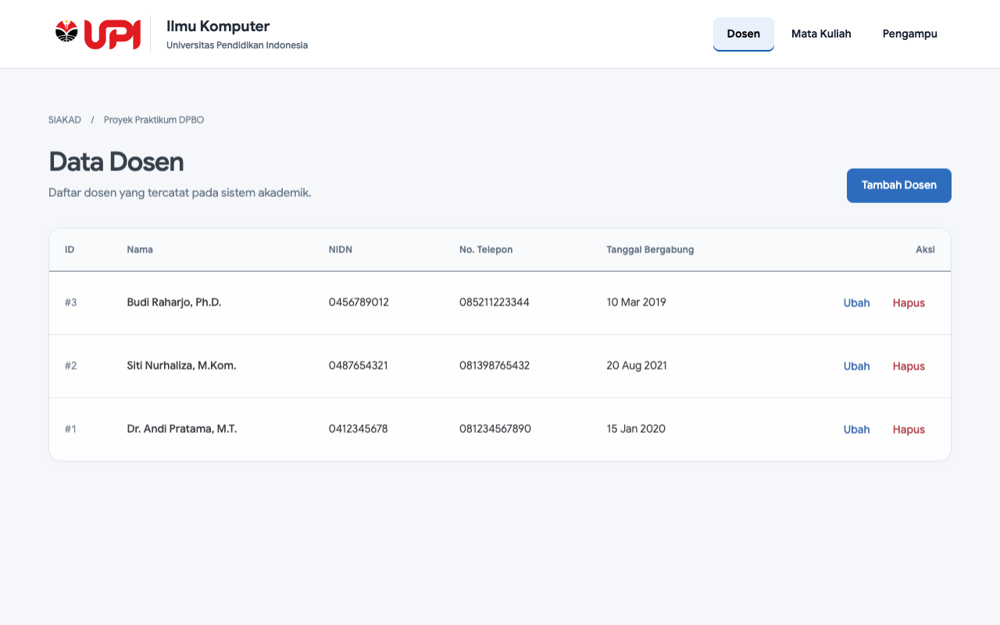 | 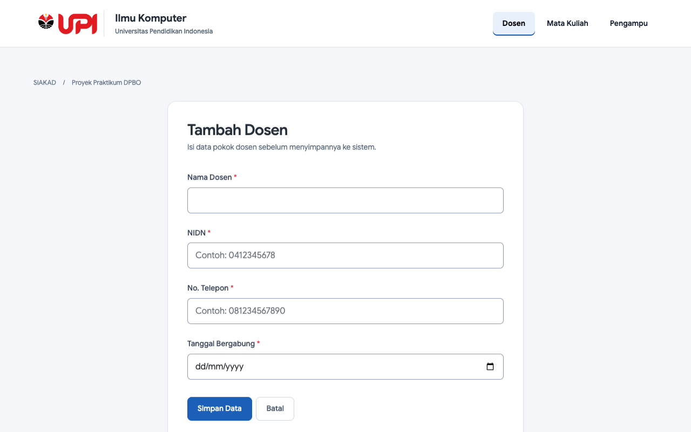 |
| **Form Ubah Dosen** | **Validasi Error Dosen** |
| 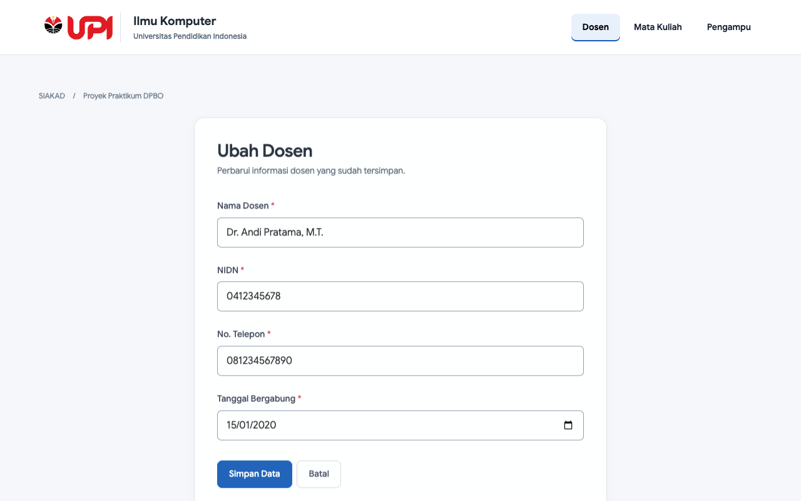 | 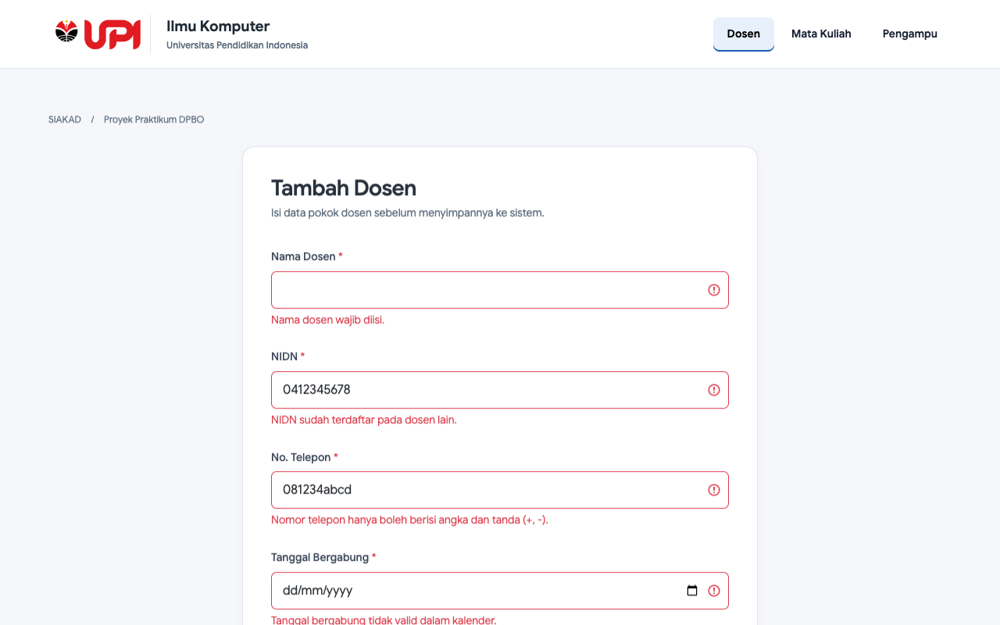 |

#### B. Entitas Mata Kuliah (`courses`)
| Daftar Mata Kuliah | Form Tambah Mata Kuliah |
|:---:|:---:|
| 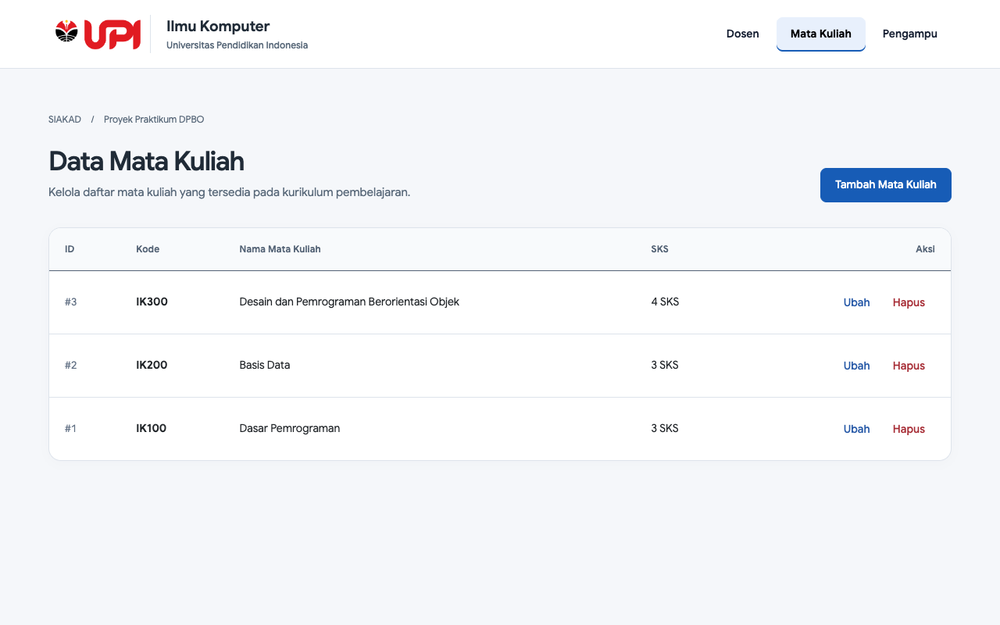 | 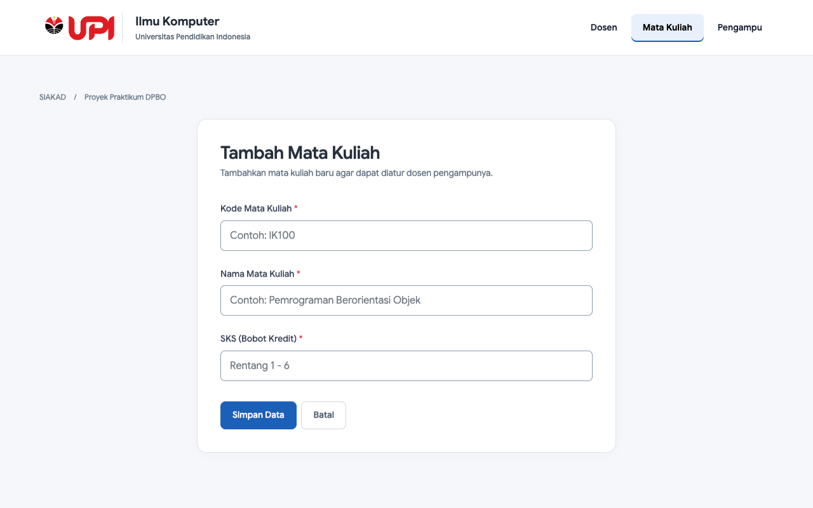 |
| **Form Ubah Mata Kuliah** | **Validasi Error Mata Kuliah** |
| 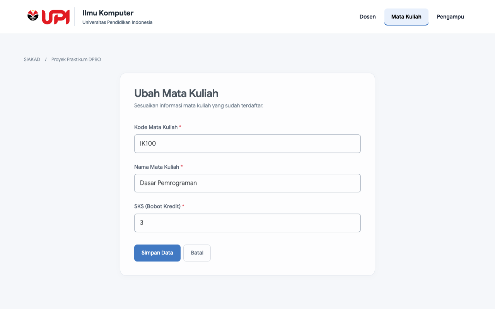 | 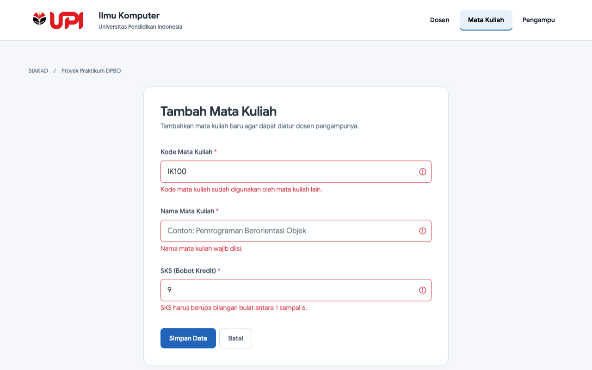 |

#### C. Entitas Pengampu (`teaching_assignments`)
| Daftar Pengampu | Form Tambah Pengampu |
|:---:|:---:|
| 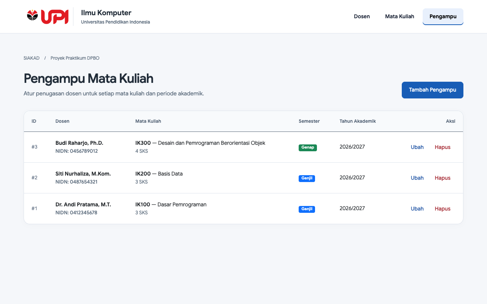 | 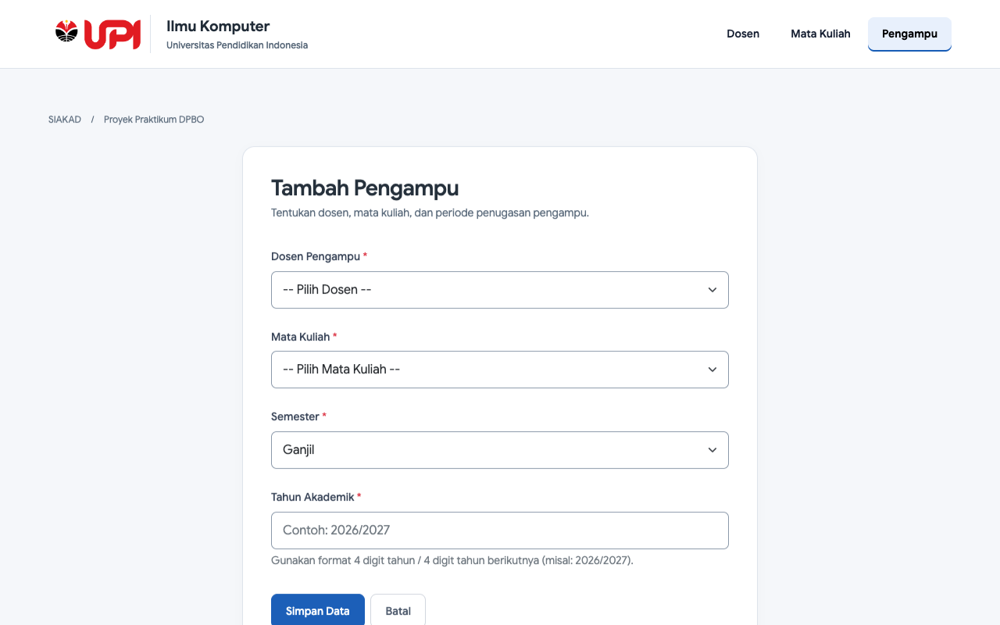 |
| **Form Ubah Pengampu** | **Validasi Error Pengampu** |
| 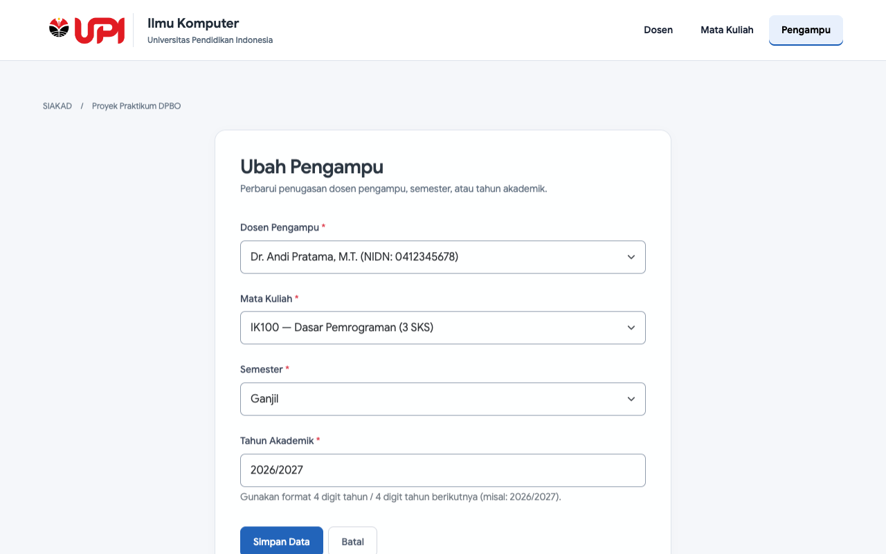 | 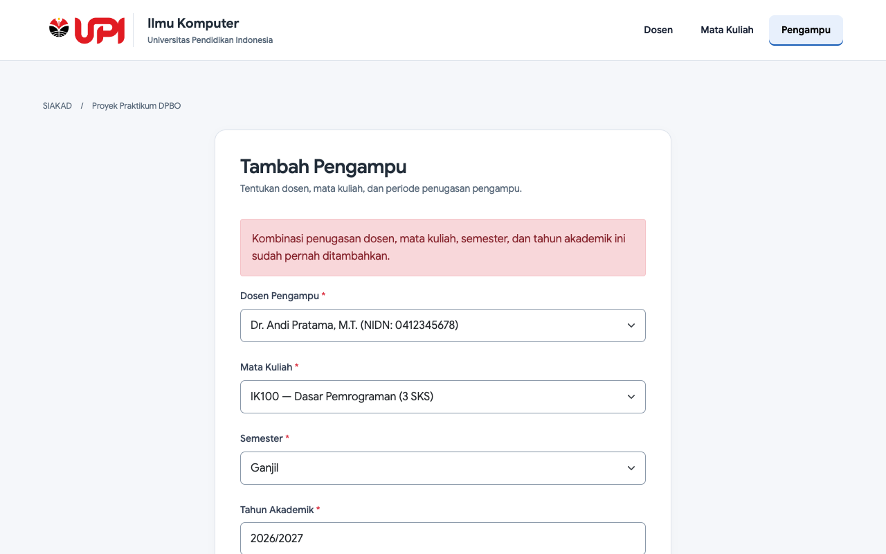 |

